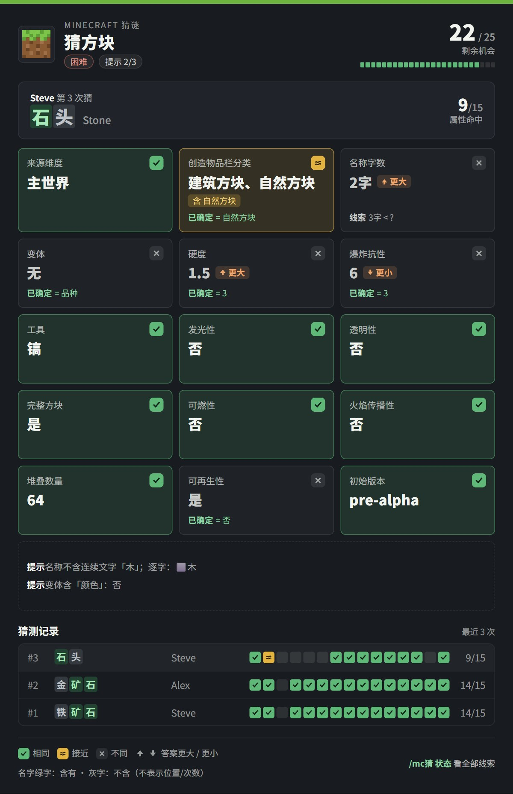
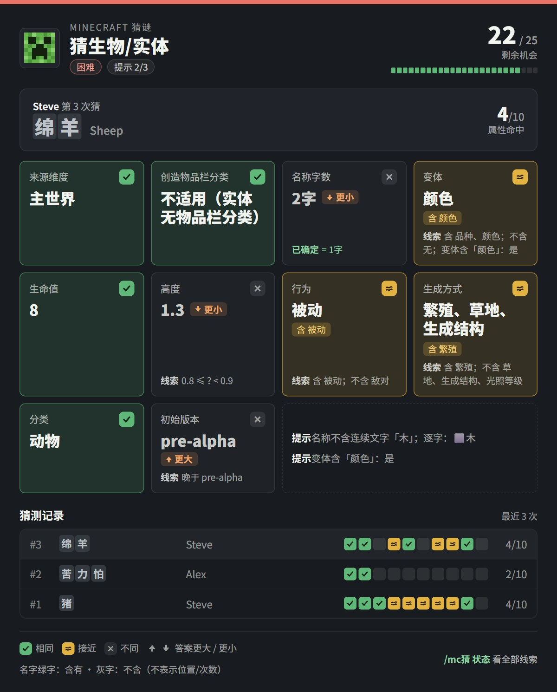
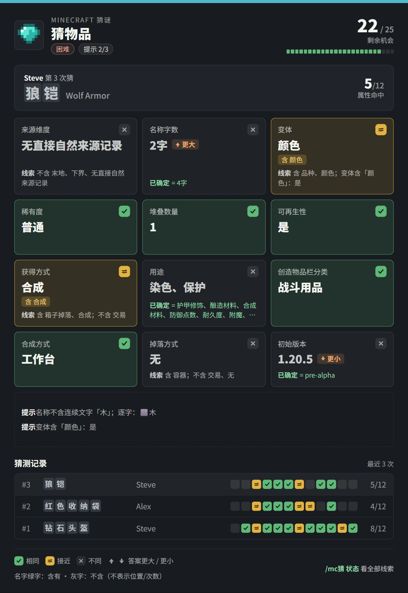
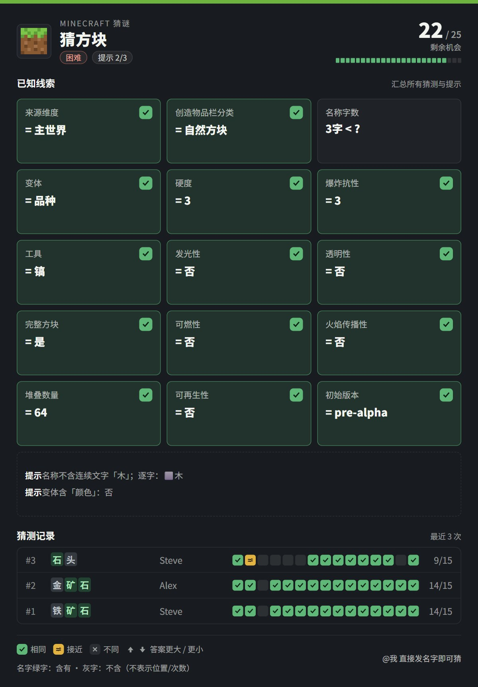
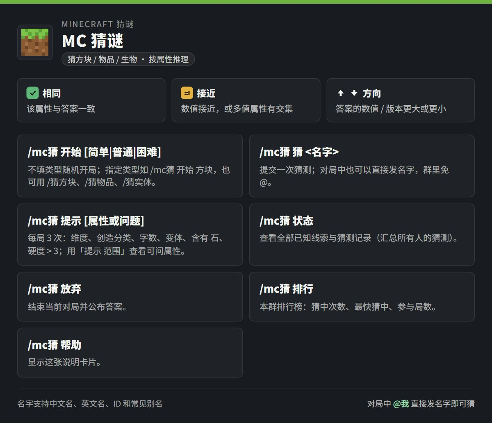

# 我的世界·猜谜（MCGuess）

[](https://github.com/AstrBotDevs/AstrBot)
[](LICENSE)

在聊天里玩《我的世界》猜谜：每次猜一个**方块 / 物品 / 生物或实体**，按属性对比逐步锁定答案。支持群聊协作、免费提示、排行榜、自然语言与本地渲染的卡片。

<p align="center"></p>

## 效果预览

|  方块卡（示例） |  生物卡（示例） |  物品卡（示例） |
| --- | --- | --- |
|  |  |  |

| 线索卡 | 排行卡 | 帮助卡 |
| --- | --- | --- |
|  |  |  |

> 预览图中的对局、玩家与排行数据为演示数据；词库、答案与属性比较逻辑均为真实实现。

## 特性

- **属性反馈**：方块 15 项、物品 12 项、生物/实体 10 项属性逐项对比，包含来源维度、创造物品栏分类、名称字数与变体；数值还会提示「答案更大 / 更小」。
- **名称含字**：每次猜测逐字标记答案是否含有该字；也可单独问「名字里有石吗」。仅判断是否出现，不表示位置和出现次数。
- **全群协作**：所有人的猜测共享线索，`/mc猜 状态` 自动汇总每个属性的已知范围。
- **免命令直猜**：对局中直接发名字即可；群聊默认免 @（整句精确词条名或「我猜X」）。
- **25 次机会**、每局 3 次免费提示，难度分简单 / 普通 / 困难。
- **排行榜**：按群统计猜中次数、最快猜中、参与局数。
- **自然语言**：LLM 工具支持「我要猜个方块」「还剩几次」「给个提示」。
- **本地渲染**：Playwright 本地截图，热态约 0.1 秒；失败自动回退远端 / 纯文本。
- 词库 1204 方块 / 1509 物品 / 153 生物与实体，覆盖 Java 1.21.9 三类完整注册表；管理员物品、技术方块和命令实体均可成为答案，运行时零联网。

## 快速开始

1. **安装插件**：把本目录放进 AstrBot 的 `data/plugins/astrbot_plugin_mcguess/`，或在 WebUI 插件页安装 / 重载；AstrBot 会按 `requirements.txt` 安装 `playwright`。
2. **本地渲染（可选）**：装一次 Chromium；不装也能用，会自动回退远端 / 文本。

   ```bash
   .venv/bin/python -m playwright install chromium
   ```

3. **开一局**：在群里发送 `/mc猜 开始`，系统会随机选择方块、物品或生物/实体中的一类，并显示本局类型；之后直接发名字猜。也可用 `/mc猜 开始 方块` 指定类型。

## 指令

| 指令 | 说明 |
| --- | --- |
| `/mc猜 开始 [方块\|物品\|生物\|实体] [简单\|普通\|困难]` | 开一局；省略类型则随机选一类，默认普通；生物与实体使用同一题库 |
| `/mc猜 开始 困难` | 不指定类型，随机选择一类并使用该类完整答案池 |
| `/猜方块`、`/猜物品`、`/猜生物`、`/猜实体` | 直接开对应类别（可带难度） |
| `/mc猜 猜 <名字>`；或对局中直接发名字 | 提交猜测 |
| `/mc猜 提示` | 免费提示（每局 3 次） |
| `/mc猜 提示 维度`、`/mc猜 提示 创造分类`、`/mc猜 提示 字数` | 询问指定属性 |
| `/mc猜 提示 变体`、`/mc猜 提示 变体 颜色` | 查询宽泛变体标签，或判断是否有颜色变体；也支持 `提示 有颜色变体吗` |
| `/mc猜 提示 含有 石` | 判断连续文字是否出现在答案名称中，并逐字标记含有/不含 |
| `/mc猜 提示 硬度 大于 3`、`/mc猜 提示 维度 下界` | 比较数值或判断属性取值；也可用 `/mc猜 问 ...` |
| `/mc猜 提示 范围` | 查看本局全部可问属性，不扣提示次数 |
| `/mc猜 状态` | 已知线索 + 猜测记录 |
| `/mc猜 放弃` | 结束并公布答案 |
| `/mc猜 排行` | 本群排行榜 |
| `/mc猜 帮助` | 玩法说明卡片 |

## 配置

配置文件：`data/config/astrbot_plugin_mcguess_config.json`（也可在 WebUI 修改）。

提示默认每局 3 次，`hint_limit` 可设为 0–50。自动提示、指定属性、含字问题和判断问题共用次数；重复同一问题、无法识别的问题、查看范围不扣次数。询问只消耗提示，不算一次猜测，也不会因为问中了完整名字而自动结束对局。

| 配置 | 默认 | 说明 |
| --- | --- | --- |
| `max_attempts` | `25` | 每局机会数（3-50） |
| `hint_limit` | `3` | 免费提示次数，`0` 关闭 |
| `render_cards` | `true` | 图片卡片开关 |
| `render_backend` | `auto` | `auto` / `local` / `remote` |
| `render_scale` | `1.5` | 本地渲染倍率（0.5-2.0） |
| `group_guess_without_at` | `true` | 群聊免 @ 直猜 |
| `llm_tool_enabled` | `true` | 注册 LLM 工具 `mc_guess` |
| `idle_timeout_minutes` | `30` | 闲置自动结束，`0` 不限制 |

<details>
<summary>全部配置项</summary>

| 配置 | 默认 | 说明 |
| --- | --- | --- |
| `card_image_format` | `jpeg` | 卡片格式：`jpeg` 体积小、`png` 最锐利 |
| `card_image_quality` | `80` | JPEG 质量（30-95） |
| `browser_path` | 空 | Chromium 路径；留空用 `playwright install` 的浏览器 |
| `local_render_timeout_seconds` | `20.0` | 本地渲染超时（含首次启动浏览器） |
| `remote_render_fallback` | `true` | 本地失败时回退远端 html_render |
| `render_timeout_seconds` | `15.0` | 远端回退渲染超时 |
| `free_text_guess` | `true` | 对局中直接发名字即算猜测 |
| `llm_tool_cards_only` | `true` | LLM 调用时只发卡片，不再请求模型补文字 |
| `require_finish_in_group` | `true` | 群聊中上一局未结束时不允许开新局 |

</details>

<details>
<summary>反馈含义、属性维度与词库</summary>

| 符号 | 含义 |
| --- | --- |
| 🟩 | 与答案完全一致 |
| 🟨 | 部分符合（多值属性有交集）或数值接近 |
| ⬜ | 不一致 |
| ⬆ / ⬇ | 数值类属性：答案比猜测更大 / 更小 |

- 多值属性（获得方式、用途、生成方式、生物分类等）按集合比较，有交集标 🟨 并列出命中项。
- 数值带容差：硬度 ±0.5、爆炸抗性相对 25%、生命值 ±2、体型高度 ±0.1；堆叠数量要求精确。
- 「初始版本」按先后比较，同一大版本（`1.16` 与 `1.16.2`、`Alpha 1.0.x`）判 🟨。

| 类别 | 比较属性 |
| --- | --- |
| 方块 | 来源维度、创造物品栏分类、名称字数、变体、硬度、爆炸抗性、工具、发光性、透明性、完整方块、可燃性、火焰传播、堆叠数量、可再生性、初始版本 |
| 物品 | 来源维度、名称字数、变体、稀有度、堆叠数量、可再生性、获得方式、用途、创造物品栏分类、合成方式、掉落方式、初始版本 |
| 生物/实体 | 来源维度、创造物品栏分类（不适用）、名称字数、变体、生命值、注册体型高度、行为、生成方式、分类、初始版本 |

「变体」只显示 **颜色 / 品种 / 无**，可以同时显示「颜色、品种」。颜色覆盖原版颜色系列与可染色内容；品种概括既定的同类系列及游戏内变种，不细分木种、材质等类别，不列具体颜色、成员名称或数量。具体成员与统称均可带标签，例如红色羊毛为「颜色」，橡木门为「品种」，皮革帽子为「颜色、品种」。无表示不在已整理的变体系列中；普通开关、姿态、年龄、氧化程度与任意自定义数据不单独算变体。对比沿用集合规则：全部一致为绿、部分重合为黄、没有交集为灰。

来源维度指原版自然生成、实体自然出现，以及物品直接采集、掉落或结构战利品的来源记录，不是“能带到哪里”。不会沿合成材料追溯维度；没有记录的合成、制造或命令内容显示「无直接自然来源记录」，仍可作为答案。创造分类来自 Java 1.21.9 原版创造标签页（启用管理员权限），保留多分类；没有物品形态的方块显示「不在创造分类中」，实体本身显示「不适用」。名称字数以词库中文显示名计数，含标点，不计空白；含字以该显示名为准，不对别名、英文名或 ID 额外判定。

提示可问当前类别的全部比较属性、首字、字数、名字含字；数值支持 `>`、`≥`、`<`、`≤`、`=`、`≠`，版本支持早于/晚于，枚举和集合支持包含/不含。判断题只显示所问条件的真假，不会顺带揭示完整隐藏属性。已有提示与猜测中的文字标记会保留在状态卡及存档中。

词库随插件分发（Minecraft 1.21.9，运行时零联网）：

| 类别 | 词条 | 简单池 | 普通池 | 困难池 |
| --- | --- | --- | --- | --- |
| 方块 | 1204 | 75 | 1054 | 1204 |
| 物品 | 1509 | 87 | 1276 | 1509 |
| 生物/实体 | 153 | 51 | 112 | 153 |

另有 263 条别名（中英文、常见口语/错写）与 56 个版本。全部 2866 个词条均可作为答案；困难池就是对应类别的完整词库，管理员/技术内容按难度分级，不再按生存可获得性排除。

覆盖全部 1166 个方块 ID、1488 个物品 ID 和 153 个实体类型 ID，另保留 38 个方块概念词条与 21 个物品概念词条。包括空气、液体、屏障、命令方块、结构方块、调试棒、知识之书、全部刷怪蛋，以及投射物、载具、展示实体、标记实体、玩家模型和玩家实体类型。

完整范围以注册 ID 为单位；附魔等级、自定义组件、任意书本内容等配置不无限展开。无对应物品形式的方块，堆叠数量显示「无物品形式」；没有生命实体生命值属性的技术/非生命实体，生命值显示「不适用」，高度使用注册体型，不代表任意运行时缩放或姿态。数据来源与字段整理方法见 `tools/mcdle_raw/README.md`。

要使用完整答案池，可发送 `/mc猜 开始 方块 困难`、`/mc猜 开始 物品 困难` 或 `/猜实体 困难`。

</details>

<details>
<summary>开发、模块与已知限制</summary>

```bash
# 在仓库根目录（本插件的上一级）运行
python -m pytest astrbot_plugin_mcguess/tests
python -m ruff check astrbot_plugin_mcguess

# 重新生成词库（离线，输入在 tools/mcdle_raw/）
python astrbot_plugin_mcguess/tools/build_catalog.py
```

| 文件 | 职责 |
| --- | --- |
| `main.py` | 插件入口：命令解析、自由文本、LLM 工具、卡片/文本回复 |
| `core.py` | 纯玩法逻辑：属性比较、回合状态机、提示生成、线索汇总 |
| `catalog.py` | 词库加载、校验、中英文/别名解析 |
| `game_service.py` | 每会话对局持久化、超时、排行榜统计 |
| `card_renderer.py` | HTML 卡片模板（stdlib only） |
| `card_views.py` | 把存档对局转换成卡片数据 |
| `renderer.py` | 本地 Playwright 渲染：浏览器生命周期与截图 |
| `render_service.py` | 渲染调度：后端选择、超时、熔断、远端回退 |
| `llm_tool.py` | LLM 工具参数校验与 JSON 结果 |

- 群聊免 @ 直猜依赖全消息监听；若该群禁用了本插件或其它插件先 `stop_event`，请改用 @机器人。
- 排行榜按群统计，用发送者 ID 识别玩家，改昵称不丢记录；v1.4.0 之前完成的对局不计入。
- 三类词库覆盖 Java 1.21.9 全部注册 ID，并保留「门」「原木」「剑」「船」等原有概念入口；「生物」类别同时收录全部实体类型。
- 本地渲染首次使用需启动 Chromium（约 1–2 秒），之后复用；未安装浏览器或字体时自动回退。
- 图片卡片能否发送取决于平台是否支持图片消息。

</details>

## 兼容性

- AstrBot `>=4.16,<5`（在 4.29.3 上验证），Python 3.10+
- 平台：aiocqhttp / Telegram / Discord 等（图片与 @ 能力取决于平台适配器）

## 数据与许可

- 词条数据整理自 [Minecraft Wiki](https://minecraft.wiki/)（CC BY-NC-SA 系），初始数据参考 [koishi-plugin-mcdle](https://github.com/araea/koishi-plugin-mcdle)（MIT OR Apache-2.0）。
- 三类完整注册表、默认物品组件、官方中英文名与配方/掉落表来自 Java 1.21.9 游戏数据的 [misode/mcmeta](https://github.com/misode/mcmeta) 提取结果；方块硬度/爆炸抗性等属性和实体注册体型参考 [PrismarineJS/minecraft-data](https://github.com/PrismarineJS/minecraft-data) 的同版本提取数据。固定提交与来源指纹见 `tools/mcdle_raw/registry_1_21_9.json`。
- 本项目与 Mojang / Microsoft 无关，是非官方同人作品；**因数据含 CC BY-NC-SA 内容，请勿用于商业用途**。
- 代码以 MIT 许可证发布，见 [LICENSE](LICENSE)。

更新日志见 [CHANGELOG.md](CHANGELOG.md)。
